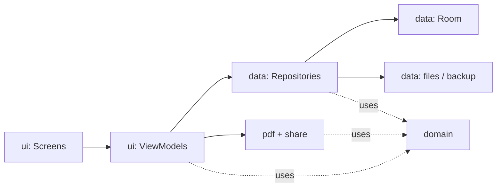

# Architecture

**Status: draft (P3-T04), awaiting founder review.** An app skeleton exists (navigation and theme only). Related: data layer in [DATA_MODEL.md](DATA_MODEL.md), screens in [UX_SPEC.md](UX_SPEC.md), scope in [MVP_SPEC.md](MVP_SPEC.md). Builds on DECISIONS D-003 and D-005.

## 1. Shape
- **One Android app module** (`:app`), with layers kept apart by **packages and rules** rather than separate Gradle modules. That's simpler to build and understand now. Splitting into modules later is possible because the rules below already keep the layers separate.
- Single activity, Jetpack Compose screens, Navigation Compose (UX_SPEC 1).
- **No server, no accounts, no network**: the manifest has no `INTERNET` permission (MVP_SPEC 8).

## 2. Packages and what each one owns

```
com.example.pocketbill
├── app/        PocketBillApplication, AppContainer (creates and holds shared objects)
├── domain/     Pure Kotlin. No Android imports. The rules of the business.
│   ├── money/        Money, CurrencyCode, currency table, parser, calculator (DATA_MODEL 6)
│   ├── invoice/      Invoice model, status rules, overdue, numbering, validation, snapshots
│   ├── format/       The one formatter for dates, money, quantities (UX_SPEC 7.2)
│   └── time/         Clock interface ("what is today?"), so tests can fix the date
├── data/       Everything stored on the phone
│   ├── db/           Room entities, DAOs, PocketBillDatabase, migrations (DATA_MODEL 1, 7)
│   ├── repository/   InvoiceRepository, ClientRepository, ProfileRepository, PresetRepository
│   ├── backup/       Backup file writer/reader, format versions, validation (MVP_SPEC 7)
│   └── files/        Logo storage (content-named files), PDF cache
├── pdf/        InvoicePdfRenderer: draws a finished invoice with Android's PdfDocument (MVP_SPEC 6)
├── share/      Builds the Android intents for email, share sheet and "save as" (UX_SPEC 4)
└── ui/
    ├── theme/        Design tokens (UX_SPEC 8)
    ├── navigation/   Routes and the nav graph (UX_SPEC 1)
    ├── components/   Shared composables: invoice row, status chip, money field…
    └── <feature>/    home/, invoices/, editor/, clients/, settings/, setup/
                      Each has: Screen (composables), ViewModel, UiState
```

## 3. Layer rules


Arrows show **who may call whom**. Nothing calls "upwards", and `domain` depends on nothing.

| Layer | Responsible for | Must **not** |
|---|---|---|
| **Screens** (composables) | Drawing `UiState`, sending user actions to the ViewModel, accessibility semantics (UX_SPEC 7.1) | Touch the database, files or intents. Do maths or formatting beyond calling `domain/format`. Hold business state in `remember` (only UI details like "is this menu open"). |
| **ViewModels** | One per screen. Turn repository data into a `StateFlow<UiState>`. Handle actions. Keep editor input as typed text until it's parsed (DATA_MODEL 6.3). Run autosave timing (UX_SPEC 3). Ask `pdf` for a file and `share` for an intent when the user sends. | Use Room entities in the UI state (map them to UI models). Reference `Context`, `Activity` or composables. Do blocking work on the main thread. |
| **Repositories** | The **only** code that reads or writes the database and files. Run each atomic operation in one `@Transaction` (DATA_MODEL 3): issuing, snapshots, numbering, restore. Enforce invariants I-1…I-10. Expose `Flow`s. | Contain screen logic. Format text for display. |
| **domain** | Money, calculations, parsing, formatting, numbering, overdue, validation, snapshot building: **all pure functions**, deterministic, fully unit tested (DATA_MODEL 6.5). | Import anything from `android.*` or `androidx.*`. Read the clock directly (it uses `Clock`). |
| **pdf** | Given a finished invoice model (frozen details, items, totals), draw pages to a file. Pagination and fonts (MVP_SPEC 6). | Read the database: it receives everything it needs. Use the app theme (it uses `PdfColors`, UX_SPEC 8.1). |
| **share** | Build intents: email with selector, chooser with callback, "save as" (UX_SPEC 4). Grant read access to only the chosen app. | Generate PDFs or change data (the ViewModel records "sent" through the repository). |

**Enforced by a test:** a unit test scans `domain/` source files and fails if any imports `android.` or `androidx.`. That's a cheap guard that keeps the business rules testable without a phone.

## 4. Key choices

| Topic | Choice | Why |
|---|---|---|
| **Dependency injection** | **Manual**: one `AppContainer`, created in `PocketBillApplication`, builds the database, repositories, `Clock` and PDF renderer. ViewModels get them through a `ViewModelProvider.Factory`. | Few objects, no extra library or code generation (Hilt). Easy to follow for a first app. Can switch to Hilt later if it grows. |
| **Screen state** | One immutable `UiState` data class per screen, exposed as `StateFlow`, collected with `collectAsStateWithLifecycle`. | Predictable, survives rotation, easy to test |
| **One-off events** (show a message, open the share sheet) | Part of `UiState` (e.g. `pendingShare: ShareRequest?`), cleared by the screen once handled | Avoids events lost on rotation |
| **Threads** | Room runs queries on its own background thread; repositories use `withContext(Dispatchers.IO)` for files; PDF rendering runs on `Dispatchers.Default`. Nothing slow on the main thread. | Smooth UI (MVP_SPEC 8 performance) |
| **Errors** | Repositories return a small sealed `Outcome`: success, or a typed failure such as `ValidationFailed`, `StorageFull`, `NumberTaken`. ViewModels turn these into the messages written in UX_SPEC. Unexpected exceptions are caught at the ViewModel and shown as "Something went wrong. Your data is safe." The details are logged on the phone only. | Users see plain messages, and nothing fails silently |
| **Time** | A `Clock` interface provides "today" (epoch day) and "now" (ms). Tests use a fixed clock. | Overdue rules and autosave are testable |
| **Serialization** | kotlinx.serialization for snapshots, backup files and type-safe navigation routes | One library for all three (needs its Gradle plugin, added in P4-T01) |
| **Logging** | Android `Log` in debug builds only. No analytics or crash-reporting SDK in the MVP (MVP_SPEC 8). | Privacy |

## 5. Testing by layer
| Layer | Test type | Runs on |
|---|---|---|
| domain | JUnit unit tests, including the DATA_MODEL 6.5 list and property tests | Computer (fast; on every build) |
| ViewModels | Unit tests with fake repositories and a fixed `Clock` | Computer |
| Repositories + Room | Instrumented tests with an in-memory database: transactions, invariants, numbering (DATA_MODEL 5.7) | Galaxy A72 |
| Migrations | `MigrationTestHelper` (DATA_MODEL 7.3) | Galaxy A72 |
| pdf | Instrumented: renders sample invoices, checks page count, text present, and the D-007 characters | Galaxy A72 |
| Screens | Compose UI tests for the T1–T5 flow; manual TalkBack pass | Galaxy A72 |

## 6. Changes from the original draft (D-003)
The original draft stands, with these changes:
- **PDF and sharing are called by ViewModels,** not through repositories. The renderer only draws data it is given, so it doesn't need repository access, and this keeps repositories focused on storage.
- **Added:** manual dependency injection, the pure-Kotlin rule for `domain` (checked by a test), `share/` as its own package, the `Clock` interface, and the `Outcome` error type.
