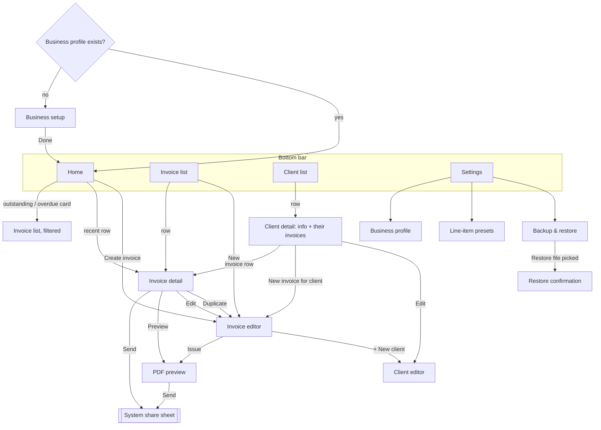

# UX Specification (Phase 2)

_Started 2026-10-16. Implements the screens in [MVP_SPEC.md](MVP_SPEC.md) section 3. Each Phase 2 task adds a section here._

| Task | Section | Status |
|---|---|---|
| P2-T01 Navigation | 1 | Draft, awaiting founder review |
| P2-T02 Home | — | Not started |
| P2-T03 Invoice editor | — | Not started |
| P2-T04 Sending (PDF preview / send) | 4 | Draft, awaiting founder review |
| P2-T05 History & statuses | — | Not started |
| P2-T06 Client management | — | Not started |
| P2-T07 Accessibility & localization | — | Not started |
| P2-T08 Design tokens | — | Not started |

---

## 1. Navigation (P2-T01)

### Design goals, from validation
1. **Quick tasks first** (A-02: check status, quick edit, re-send). Each must be reachable in **≤ 2 taps from opening the app**.
2. **Sending is never hidden** (T3 had the most friction). It is the primary button wherever an invoice is shown in full.
3. **Creating is fast enough to beat the laptop** (D-010). Create is always one tap from Home and Invoices, and Duplicate is one tap from any invoice.

### Structure

Single activity, Navigation Compose. Four bottom-bar tabs, each **keeping its own back stack**: leaving the Invoices tab while on an invoice and coming back returns to that invoice.



### Routes

Type-safe Navigation Compose routes (`@Serializable` objects and classes). This needs the Kotlin serialization plugin, which is added in P4-T01.

| Route | Arguments | Bottom bar | Notes |
|---|---|---|---|
| `Setup` | — | Hidden | Only when no business profile exists. Removed from the back stack when done (`popUpTo(Setup) { inclusive = true }`). |
| `Home` | — | Shown | Start destination of tab 1 |
| `InvoiceList` | `filter: Status? = null` | Shown | Start of tab 2. Home's cards open it pre-filtered (Unpaid, Overdue). |
| `ClientList` | — | Shown | Start of tab 3 |
| `Settings` | — | Shown | Start of tab 4 |
| `InvoiceDetail` | `invoiceId: Long` | Shown | |
| `InvoiceEditor` | `invoiceId: Long? = null`, `duplicateOf: Long? = null`, `clientId: Long? = null` | **Hidden** | Full-screen task with more room for the keyboard. New, edit, duplicate, or new for a given client. |
| `PdfPreview` | `invoiceId: Long` | **Hidden** | |
| `ClientDetail` | `clientId: Long` | Shown | |
| `ClientEditor` | `clientId: Long? = null`, `returnToEditor: Boolean = false` | Hidden | When opened from the invoice editor, the new client is selected on return. |
| `BusinessProfile`, `Presets`, `Backup` | — | Shown | Inside the Settings tab |
| `RestoreConfirm` | `fileUri: String` | Hidden | Shows counts before replacing data (MVP_SPEC section 7) |

### Back behaviour
| Situation | Back goes to | Why |
|---|---|---|
| Editor, any time | Previous screen. The **draft is already autosaved**, so there is **no "discard changes?" dialog**; a short message says "Draft saved". | Interruptions on a phone are normal; nothing is lost (UP-01). |
| Editor → **Issue** → Preview | Back from Preview goes to **Invoice detail**, not the editor. The editor is replaced (`popUpTo(InvoiceEditor) { inclusive = true }`, then Detail, then Preview). | After issuing, the invoice is "done". Returning to the form would feel like it wasn't saved. |
| Editing an issued invoice → **Save** | Back to where the edit started (Detail or Preview), which shows the updated data | Same as the prototype |
| Draft deleted from the editor | Back to the list it came from, with "Draft deleted · Undo" | |
| Tab re-selected while already on that tab | Pops to the tab's start screen | Standard Android behaviour |
| Back on a tab's start screen (not Home) | Home | Standard Material behaviour |
| Back on Home | Leaves the app | |

### Quick-task tap counts (target vs this design)
| Task | Path | Taps |
|---|---|---|
| "Who owes me?" | Open app → Home shows outstanding per currency and overdue count | **0** |
| See overdue invoices | Home → Overdue card | **1** |
| **Re-send an invoice** | Home → recent row → **Send** → pick app | **2** + pick app |
| Re-send an older one | Invoices tab → row → **Send** | **2** + pick app |
| Quick edit (e.g. due date) | Home/Invoices → row → Edit → change → Save | 4 |
| Mark paid | row → **Mark paid** | **2** |
| New invoice for a repeat client | Home → Create → pick from **recent clients** (top 3 shown as chips) → pick a preset item → Issue → Send | ~6–8 taps plus typing the amount |
| **Duplicate last month's invoice** | Row → **Duplicate** → (adjust) → Issue → Send | **4** + pick app |

### Invoice detail: action order
Following the T3 finding, the detail screen shows actions in this order:
1. **Email to client** (or **Send…** when the client has no email): filled primary button, showing "Last sent 16 Oct via Gmail" underneath when sent before. Details in section 4.
2. **Mark as paid** (or "Mark as unpaid"): tonal button.
3. Row of icon buttons with labels: **Preview**, **Edit**, **Duplicate**, **More** (Void, Delete draft).

Drafts show **Issue** instead of Send, and Mark paid is hidden.

### What this deliberately leaves out
- **No navigation drawer**: four tabs cover everything.
- **No floating "+" button**: Create is a full-width button on Home and a button on the Invoices list. A floating button on a phone screen covers the last list row, and the T3 testing showed people miss small controls.
- **No swipe actions on list rows** in the MVP: they're invisible to new users and to TalkBack. They could be added later as a shortcut.
- **No incoming deep links**: nothing outside the app opens PocketBill screens. The F-17 due-date notification (Could) would open Invoice detail.

### To validate
- Section 4 (P2-T04) defines the sending redesign and its check with 2–3 participants.
- Whether **recent clients as chips** plus **presets** bring a repeat invoice under 2 minutes is measured by P1-T07.

---

## 4. Sending an invoice (P2-T04)

### The problem
In usability testing, **T3 ("Send the PDF to the client") caused the most friction** (VALIDATION_RESULTS.md). The cause wasn't recorded, so the design targets the four likely causes visible in the prototype:

| # | Likely cause | Fix in this design |
|---|---|---|
| C1 | **Finding** Send: it sat in a bottom bar on the preview only, beside Edit and Save | Send is the **primary button** on Invoice detail *and* PDF preview (UX_SPEC 1) |
| C2 | **Too many choices**: a share sheet with 8+ apps for what is usually "email it to the client" | **"Email to client"** opens the email app directly, skipping the share sheet. Other apps sit behind "Send another way". |
| C3 | **Retyping**: the client's address, subject and message had to be entered in the email app | Everything is **prefilled** from the invoice |
| C4 | **No confirmation** afterwards that it was sent | The invoice shows **"Sent 16 Oct · Gmail"** and the button becomes **"Send again"** |

**Check it:** before Phase 4, ask 2–3 of the original participants to repeat T3 in an updated prototype. Success: each completes T3 unaided in under 30 seconds.

### Invoice detail with a client email on file (the common case)

```
┌──────────────────────────────────────┐
│ ←  INV-0014                          │
├──────────────────────────────────────┤
│ Müller Design GmbH          [Unpaid] │
│ €570.00                              │
│ Due 30 Oct 2026                      │
│                                      │
│ ┌──────────────────────────────────┐ │
│ │  ✉  Email to client              │ │  ← filled primary button
│ └──────────────────────────────────┘ │
│   to billing@mueller.example         │  ← shows where it's going
│   Send another way (WhatsApp, …)     │  ← text button: opens the share sheet
│                                      │
│ ┌──────────────────────────────────┐ │
│ │  ✓  Mark as paid                 │ │  ← tonal button
│ └──────────────────────────────────┘ │
│  Preview   Edit   Duplicate   More   │
└──────────────────────────────────────┘
```
After sending, the primary button reads **"Email again"**, with **"Last sent 16 Oct via Gmail"** under it.

### Variations
| Situation | Primary button | Secondary |
|---|---|---|
| Client has an email | **Email to client** | Send another way |
| Client has **no** email | **Send…** (opens the share sheet) | "Add client email for one-tap sending" (opens the client editor; returns here) |
| Draft | **Issue and send** → confirmation sheet: "This gives the invoice its number, INV-0015, and opens your email app." [Issue and send] [Cancel] | Preview shows a DRAFT watermark |
| Paid | **Email receipt** (the PDF carries the PAID stamp) | Send another way |
| Void | No send button. "Voided invoices can't be sent." | — |

### What "Email to client" does (Android)
1. Generate the PDF from saved data, off the main thread. A progress indicator appears only if it takes over 300 ms.
2. Write it to app cache as `INV-0014_Muller-Design-GmbH.pdf`, exposed through `FileProvider`.
3. Launch `ACTION_SEND` with:
   - `type = application/pdf`, `EXTRA_STREAM` = the content URI, plus `ClipData` and `FLAG_GRANT_READ_URI_PERMISSION` (read access only, only for the chosen app).
   - `EXTRA_EMAIL = [client email]`, `EXTRA_SUBJECT`, `EXTRA_TEXT` (template below).
   - **`selector = ACTION_SENDTO mailto:`**, which limits the choice to email apps. With one email app (usually Gmail on Android), it opens **directly** and the share sheet never appears.
4. If no email app is installed, fall back to the full share sheet and say so: "No email app found. Choose another way to send."

**"Send another way"** opens the standard chooser (`Intent.createChooser`) with the same file and text, titled "Send INV-0014".

### Recording that it was sent
Android doesn't report whether the user actually pressed Send in Gmail or WhatsApp. It only reports **which app was chosen** (the `createChooser` callback with `EXTRA_CHOSEN_COMPONENT`, or the email intent launching).
- When an app is chosen, record `lastSentAt = now` and `lastSentVia = "Gmail"`, and show "Marked as sent via Gmail · **Undo**".
- The wording says **"Sent"** in the UI, with Undo for the case where the user backed out of the email app.
- Sending never changes the invoice **status** (it stays Unpaid until marked paid).

### Email template (fixed in the MVP; editable in a later version)

**Subject:** `Invoice INV-0014 from Your Studio`
**Body:**
```
Hi Müller Design GmbH,

Please find attached invoice INV-0014 for €570.00, due on 30 Oct 2026.

Payment details:
<payment instructions from the business profile>

Thank you,
Your Studio
```
- For a paid invoice: subject `Receipt for invoice INV-0014 from Your Studio`, body "Thank you for your payment of €570.00, received on 23 Oct 2026."
- Names and amounts use the invoice's **frozen details** (DATA_MODEL section 5), so the email matches the PDF.
- Messaging apps such as WhatsApp ignore the subject and use the body as the caption.

### Save to device
Available on PDF preview and under **More** on detail: **Save PDF** opens the system "save as" picker (`ACTION_CREATE_DOCUMENT`), prefilled with the same file name. It does not count as "sent".

### Errors
| Error | Message | Action |
|---|---|---|
| PDF generation fails | "Couldn't create the PDF. Your invoice is saved." | Try again. The error details go to the local log only. |
| No app can receive a PDF (very rare) | "No app on this phone can send PDF files. Save it to the device instead." | Opens Save PDF |
| Client email is invalid | Caught when the client is saved, not at send time | — |

### Data model change
Adds `invoice.lastSentVia: String?` (the app's label, e.g. "Gmail") next to `lastSentAt` (DATA_MODEL section 1).
