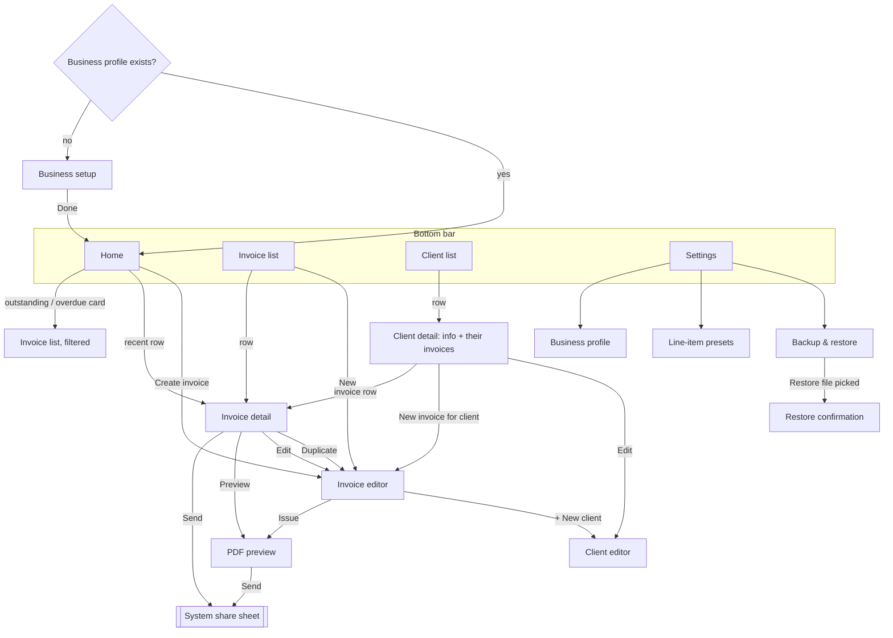
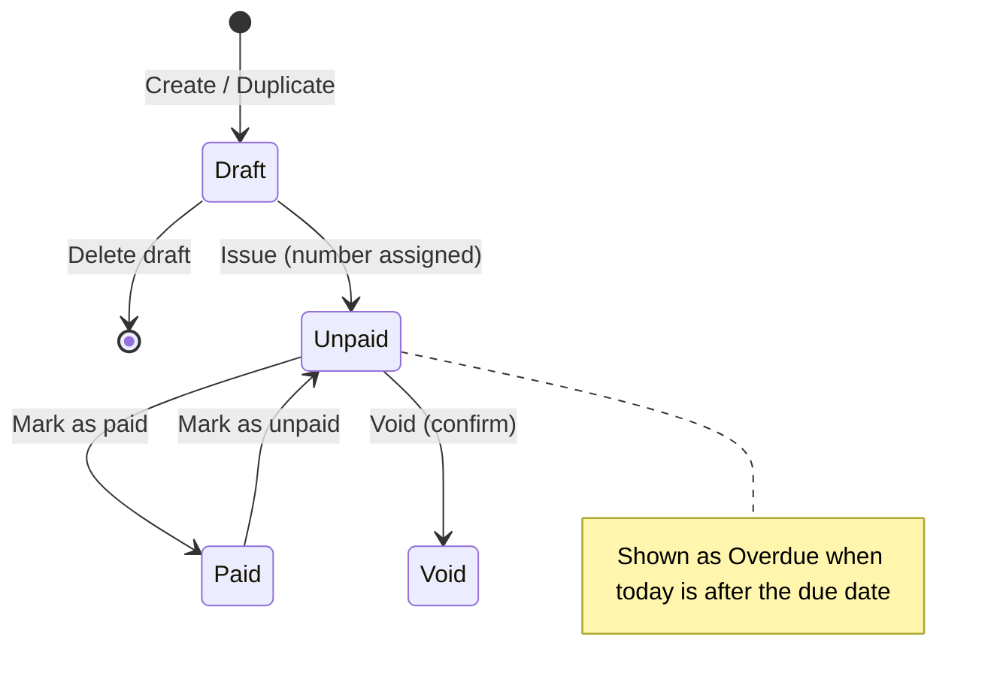

# UX Specification (Phase 2)

_Started 2026-10-16. Implements the screens in [MVP_SPEC.md](MVP_SPEC.md) section 3. Each Phase 2 task adds a section here._

| Task | Section | Status |
|---|---|---|
| P2-T01 Navigation | 1 | Draft, awaiting founder review |
| P2-T02 Home | 2 | Draft, awaiting founder review |
| P2-T03 Invoice editor | 3 | Draft, awaiting founder review |
| P2-T04 Sending (PDF preview / send) | 4 | Draft, awaiting founder review |
| P2-T05 History & statuses | 5 | Draft, awaiting founder review |
| P2-T06 Client management | 6 | Draft, awaiting founder review |
| P2-T07 Accessibility & formatting | 7 | Draft, awaiting founder review |
| P2-T08 Design tokens | 8 | Draft; **implemented in P4-T01** (`ui/theme/`) |

---

## 1. Navigation (P2-T01)

### Design goals, from validation
1. **Quick tasks first** (A-02: check status, quick edit, re-send). Each must be reachable in **≤ 2 taps from opening the app**.
2. **Sending is never hidden** (T3 had the most friction). It is the primary button wherever an invoice is shown in full.
3. **Creating is fast enough to beat the laptop** (D-010). Create is always one tap from Home and Invoices, and Duplicate is one tap from any invoice.

### Structure

Single activity, Navigation Compose. Four bottom-bar tabs, each **keeping its own back stack**: leaving the Invoices tab while on an invoice and coming back returns to that invoice.



### Routes

Type-safe Navigation Compose routes (`@Serializable` objects and classes). This needs the Kotlin serialization plugin, which is added in P4-T01.

| Route | Arguments | Bottom bar | Notes |
|---|---|---|---|
| `Setup` | — | Hidden | Only when no business profile exists. Removed from the back stack when done (`popUpTo(Setup) { inclusive = true }`). |
| `Home` | — | Shown | Start destination of tab 1 |
| `InvoiceList` | `filter: Status? = null` | Shown | Start of tab 2. Home's cards open it pre-filtered (Unpaid, Overdue). |
| `ClientList` | — | Shown | Start of tab 3 |
| `Settings` | — | Shown | Start of tab 4 |
| `InvoiceDetail` | `invoiceId: Long` | Shown | |
| `InvoiceEditor` | `invoiceId: Long? = null`, `duplicateOf: Long? = null`, `clientId: Long? = null` | **Hidden** | Full-screen task with more room for the keyboard. New, edit, duplicate, or new for a given client. |
| `PdfPreview` | `invoiceId: Long` | **Hidden** | |
| `ClientDetail` | `clientId: Long` | Shown | |
| `ClientEditor` | `clientId: Long? = null`, `returnToEditor: Boolean = false` | Hidden | When opened from the invoice editor, the new client is selected on return. |
| `BusinessProfile`, `Presets`, `Backup` | — | Shown | Inside the Settings tab |
| `RestoreConfirm` | `fileUri: String` | Hidden | Shows counts before replacing data (MVP_SPEC section 7) |

### Back behaviour
| Situation | Back goes to | Why |
|---|---|---|
| Editor, any time | Previous screen. The **draft is already autosaved**, so there is **no "discard changes?" dialog**; a short message says "Draft saved". | Interruptions on a phone are normal; nothing is lost (UP-01). |
| Editor → **Issue** → Preview | Back from Preview goes to **Invoice detail**, not the editor. The editor is replaced (`popUpTo(InvoiceEditor) { inclusive = true }`, then Detail, then Preview). | After issuing, the invoice is "done". Returning to the form would feel like it wasn't saved. |
| Editing an issued invoice → **Save** | Back to where the edit started (Detail or Preview), which shows the updated data | Same as the prototype |
| Draft deleted from the editor | Back to the list it came from, with "Draft deleted · Undo" | |
| Tab re-selected while already on that tab | Pops to the tab's start screen | Standard Android behaviour |
| Back on a tab's start screen (not Home) | Home | Standard Material behaviour |
| Back on Home | Leaves the app | |

### Quick-task tap counts (target vs this design)
| Task | Path | Taps |
|---|---|---|
| "Who owes me?" | Open app → Home shows outstanding per currency and overdue count | **0** |
| See overdue invoices | Home → Overdue card | **1** |
| **Re-send an invoice** | Home → recent row → **Send** → pick app | **2** + pick app |
| Re-send an older one | Invoices tab → row → **Send** | **2** + pick app |
| Quick edit (e.g. due date) | Home/Invoices → row → Edit → change → Save | 4 |
| Mark paid | row → **Mark paid** | **2** |
| New invoice for a repeat client | Home → Create → pick from **recent clients** (top 3 shown as chips) → pick a preset item → Issue → Send | ~6–8 taps plus typing the amount |
| **Duplicate last month's invoice** | Row → **Duplicate** → (adjust) → Issue → Send | **4** + pick app |

### Invoice detail: action order
Following the T3 finding, the detail screen shows actions in this order:
1. **Email to client** (or **Send…** when the client has no email): filled primary button, showing "Last sent 16 Oct via Gmail" underneath when sent before. Details in section 4.
2. **Mark as paid** (or "Mark as unpaid"): tonal button.
3. Row of icon buttons with labels: **Preview**, **Edit**, **Duplicate**, **More** (Void, Delete draft).

Drafts show **Issue** instead of Send, and Mark paid is hidden.

### What this deliberately leaves out
- **No navigation drawer**: four tabs cover everything.
- **No floating "+" button**: Create is a full-width button on Home and a button on the Invoices list. A floating button on a phone screen covers the last list row, and the T3 testing showed people miss small controls.
- **No swipe actions on list rows** in the MVP: they're invisible to new users and to TalkBack. They could be added later as a shortcut.
- **No incoming deep links**: nothing outside the app opens PocketBill screens. The F-17 due-date notification (Could) would open Invoice detail.

### To validate
- Section 4 (P2-T04) defines the sending redesign and its check with 2–3 participants.
- Whether **recent clients as chips** plus **presets** bring a repeat invoice under 2 minutes is measured by P1-T07.

---

## 2. Home (P2-T02)

### The job
Home answers the validated phone tasks **without a tap** (A-02, A-03): *Who owes me? Is anything overdue? Is there something I started and didn't finish?* It also starts a new invoice in one tap.

### Layout (normal use)

```
┌──────────────────────────────────────┐
│ Your Studio                          │
├──────────────────────────────────────┤
│ ┌──────────────────────────────────┐ │
│ │ Outstanding                      │ │  ← tap: Invoices, Unpaid filter
│ │ $1,200.00                        │ │
│ │ €570.00                          │ │
│ │ £800.00                          │ │
│ │ 4 unpaid invoices                │ │
│ ├──────────────────────────────────┤ │
│ │ ! 1 overdue · $1,200.00        › │ │  ← tap: Overdue filter (red row)
│ └──────────────────────────────────┘ │
│ ┌──────────────────────────────────┐ │
│ │  +  Create invoice               │ │  ← filled primary button
│ └──────────────────────────────────┘ │
│                                      │
│ [card: Back up your invoices  ✕]     │  ← at most one card (below)
│                                      │
│ Needs attention                      │
│  Acme Studio · INV-0012              │
│  Overdue 8 days · $1,200   [Remind]  │
│  Müller Design · INV-0014            │
│  Issued, not sent yet      [Email]   │
│  Lumen Labs · Draft                  │
│  Started yesterday       [Continue]  │
│                                      │
│ Recent                               │
│  (last 5 invoices, same rows as the  │
│   Invoices list)                     │
└──────────────────────────────────────┘
```

### Outstanding card
- **One line per currency**, never added together. There are no exchange rates offline, and a converted total would be wrong.
- Order: the currency with the most unpaid invoices first, then by currency code. Up to 3 lines are shown; more becomes "+2 more currencies", which expands in place.
- The sub-line counts unpaid invoices. Issued invoices count; drafts and void ones don't.
- **The overdue row** appears only when something is overdue. It uses the late colour **and** a "!" icon, so colour isn't the only signal.
- TalkBack reads it as one sentence: "Outstanding: 1,200 US dollars, 570 euros, 800 British pounds. 4 unpaid invoices. 1 overdue."

### Needs attention (up to 3 rows, most urgent first)
| Order | Shows | Row action (one tap) |
|---|---|---|
| 1 | **Overdue** invoices, oldest due date first: "Overdue 8 days" | **Remind**: emails the client using the reminder template (section 4). Without a client email it opens Send…. |
| 2 | **Issued but never sent** (`lastSentAt` is empty): "Issued, not sent yet" | **Email** (or **Send…**) |
| 3 | **Drafts**, most recently edited first: "Started yesterday" | **Continue**: opens the editor |

- Tapping the row itself (outside the button) opens invoice detail.
- "See all (5)" appears when more than 3 items qualify, and opens the matching filter.
- With nothing to show, the section is hidden. No "all caught up" filler.

### Cards (at most one at a time, under Create invoice)
| Priority | Card | When | Action |
|---|---|---|---|
| 1 | "**Your payment details changed.** 3 unpaid invoices were updated. Send them again?" | After the DATA_MODEL 5.5 update | **Review**: list with Email again on each |
| 2 | "**Back up your invoices.** Your invoices exist only on this phone." | 10+ invoices since the last backup, or 30 days since it (MVP_SPEC 7) | **Back up now**. ✕ hides it for 7 days. |

### Recent
The last 5 invoices by last change, using the same row design as the Invoices list (section 5). "See all" opens the Invoices tab.

### Empty and edge states
| State | What Home shows |
|---|---|
| **First use** (no invoices) | No Outstanding card. A welcome block: "Create your first invoice. It takes about a minute." plus **Create invoice**, and one tip: "Add your clients' email addresses to send invoices in one tap." No sample data. |
| Everything paid | Outstanding card shows "**Nothing outstanding**" and "All invoices are paid." Needs attention hidden. |
| Only drafts | Outstanding shows "Nothing outstanding". Needs attention shows the drafts. |
| Loading | Data comes from the phone in well under a second, so no spinner or placeholder. |
| Pull to refresh | None: the data is always current. |

### Data needed
Existing queries (DATA_MODEL 4) plus two: issued-but-unsent (`status = 'ISSUED' AND lastSentAt IS NULL`) and recent drafts (`status = 'DRAFT' ORDER BY updatedAt DESC`).

---

## 3. Invoice editor (P2-T03)

### The goal
Validation found that people **create invoices on laptops** today (D-010). The editor has to make creating one on the phone fast enough that they'd rather not wait for the laptop. P1-T07 measures whether it works.

**Targets:**
- **Repeat client: ≤ 60 seconds** from tapping Create to the issued PDF.
- **New client: ≤ 2 minutes.**
- **Duplicate last month's invoice: ≤ 20 seconds.**

### Principles
1. **Defaults do the work.** Picking a client fills in their usual currency, payment terms and tax, taken from their last invoice. New clients get the business defaults (Settings).
2. **One screen, few fields.** Client and items are always visible. Currency, dates, tax, discount and notes sit in a one-line summary that expands when tapped.
3. **Nothing is lost.** The draft saves automatically while typing. There is no Save button for drafts and no "discard changes?" dialog.
4. **Errors appear when issuing, not while typing.** A draft can be incomplete.

### Layout (new invoice)

```
┌──────────────────────────────────────┐
│ ←  New invoice          Draft saved ⋮│  ← ⋮ = Delete draft
├──────────────────────────────────────┤
│ Client                               │
│ [Acme Studio] [Lumen Labs] [Harbor…] │  ← recent-client chips (top 3)
│ [All clients…]  [+ New client]       │
│                                      │
│ EUR · Due in 14 days (30 Oct) · No tax ›│ ← summary line; tap to expand
│                                      │
│ Items                                │
│ ┌──────────────────────────────────┐ │
│ │ Description                      │ │
│ │ Logo design▏                     │ │
│ │  ↳ Logo design (preset) €450     │ │  ← preset suggestion while typing
│ │ Qty [1    ]   Price [450.00] EUR │ │
│ │                   Line €450.00 ⋮ │ │  ← ⋮ = Remove, Move up/down, Save as preset
│ └──────────────────────────────────┘ │
│ + Add item                           │
│                                      │
│ Notes (optional)                   › │
├──────────────────────────────────────┤
│ Total €450.00          [  Issue  ]   │  ← sticky bar, stays above the keyboard
└──────────────────────────────────────┘
```

**Expanded summary line ("Invoice details"):**
| Field | Default | Control |
|---|---|---|
| Currency | Client's last currency → suggestion from the client's country (below) → business default | Searchable list, recent currencies first |
| Issue date | Today | Date picker |
| Payment due | Client's last terms → business default | Chips: **On receipt · 7 · 14 · 30 days · Custom date**. The due date is shown next to them ("30 Oct 2026"). |
| Tax | Client's last rate → business default | Percent field, with "No tax" as a one-tap option |
| Discount (F-15) | None | Percent or amount |

The summary line always shows the **currency and due date** in words, so a wrong default is visible without expanding it. The currency code also appears beside every price field and in the total.

### Choosing a client
- **Recent-client chips:** the 3 clients invoiced most recently (`client.lastInvoicedAt`). One tap selects.
- **All clients…** opens a searchable bottom sheet, with archived clients hidden.
- **+ New client** opens a short sheet: **Name** (required), **Email** (labelled "for one-tap sending", UX_SPEC 4), **Country** (optional, picked from a list). Save returns to the editor with the client selected.
- **Currency suggestion from the country:** picking Germany for a new client suggests EUR, and the United Kingdom suggests GBP. It's a suggestion chip ("Use EUR?"), never a silent change, because many freelancers bill foreign clients in USD.
- A selected client shows as a single row (name and email) with **Change**.

### Line items
- A new invoice starts with **one empty item**, cursor in the description.
- **Preset suggestions (F-18)** appear under the description after 2 typed characters: up to 3 matches, most used first. Choosing one fills the description, plus the price if its currency matches the invoice's.
- **Quantity** defaults to 1. **Price** uses the number keyboard and accepts `.` or `,` as the decimal separator. On leaving the field it's shown with the currency's decimals (`450` → `450.00`; yen shows no decimals).
- **Line total** updates live.
- **Item menu (⋮):** Remove, Move up, Move down, Save as preset. No drag-to-reorder in the MVP.
- **Add item** adds an empty item and moves the cursor to it.
- Keyboard: Description → Next → Qty → Next → Price → Done. "Done" hides the keyboard so the total and Issue button are visible.

### Issuing
**Issue** checks (DATA_MODEL invariants I-4 to I-8):
| Problem | Message (shown at the field, and the field is scrolled to and focused) |
|---|---|
| No client | "Choose a client." |
| An item with no description | "Add a description." |
| Quantity ≤ 0 or not a number | "Enter a quantity above 0." |
| Price missing or invalid | "Enter a price, like 450 or 450.00." |
| Due date before issue date | "The due date can't be before the issue date." |
| Total is 0 | Not blocked. A confirmation asks: "This invoice totals €0.00. Issue it anyway?" |

Completely empty extra items are dropped silently. On success: number assigned (DATA_MODEL 5.1), then go to **PDF preview**, where **Email to client** is the main action (UX_SPEC 4).

### Other ways into the editor
| Mode | What's prefilled | Title | Bottom button |
|---|---|---|---|
| New | Defaults only | New invoice | Issue |
| New for client (from client detail) | That client + their defaults | New invoice | Issue |
| **Duplicate** | Client, currency, items, tax, discount, notes. Dates reset: issue today, due by the same terms. **No number** (N-9). | New invoice · copy of INV-0014 | Issue |
| Edit draft | Everything as saved | Draft | Issue |
| **Edit issued (unpaid)** | Everything as saved | Edit INV-0014 | **Save changes** |

**Editing an issued invoice (a "quick edit" from validation):**
- A banner explains: "Sent on 16 Oct. Saving updates the PDF. The client won't see changes until you send it again." (If never sent: "Saving updates the PDF.")
- Changes are **not** autosaved, because this is a real document. Back with unsaved changes asks: **Save changes / Discard / Keep editing**. This is the one exception to "no discard dialog".
- After saving: back to detail with "INV-0014 updated · **Email again**" as a one-tap prompt.

### Autosave (drafts)
- Saves 500 ms after the last change, and immediately when the app goes to the background.
- The top bar shows **"Draft saved"** with a check mark after each save, and **"Saving…"** while typing. P1-T07: the one participant who gave up (P-e) wasn't sure items were being saved, so this must be clearly visible, not faint. TalkBack announces "Draft saved" once per pause, not on every keystroke. If saving fails (very rare: a full disk), it shows "Couldn't save. Your changes are kept on screen" and retries.
- A draft is created only once something has been entered. Opening New and pressing Back leaves no empty draft.
- **Delete draft** (⋮ menu) removes it, with Undo.

### Tap budget: repeat client, one preset item
| Step | Taps |
|---|---|
| Home → **Create invoice** | 1 |
| Client chip | 1 |
| Description → type 2 letters → preset suggestion | 1 + typing |
| (price prefilled; terms, currency and tax prefilled from the client) | 0 |
| **Issue** | 1 |
| **Email to client** → Send in email app | 2 |
| **Total** | **6 taps + 2 letters** |

Duplicate: row → ⋮ **Duplicate** → **Issue** → **Email** → Send = **5 taps**, with no typing.

### As built in P4-T06 (differences from the design above)
- **Errors on Issue:** a message at the top ("Some fields need attention…") plus a message at each field. The screen doesn't yet scroll to and focus the first problem; planned with the P5 accessibility pass.
- **"+ New client"** opens the full client editor and returns the new client to the invoice, rather than a short sheet.
- **Recent-client chips** appear once clients have issued invoices (`lastInvoicedAt`); before that, use "All clients…".
- **Suggestions** need 2 typed characters and show up to 3 saved items; tapping one fills the price only when its currency matches the invoice.

### Accessibility
- Every field has a visible label (not just a placeholder) and a TalkBack label.
- Errors are announced when shown (Compose `liveRegion`). The total is announced when it changes after leaving a price field, not on every keystroke.
- Chips and menu buttons are at least 48 dp.

### Data model
No new columns. The client's last currency, terms and tax come from a query on their most recent invoice. The country → currency suggestions are a fixed table in code.

### To validate
- **P1-T07** measures real creation time on the phone against the targets above.
- In the prototype, the summary line and presets aren't built yet. If P1-T07 shows creation is slow, add them to the prototype next and retest.

---

## 4. Sending an invoice (P2-T04)

### The problem
In usability testing, **T3 ("Send the PDF to the client") caused the most friction** (VALIDATION_RESULTS.md). The cause wasn't recorded, so the design targets the four likely causes visible in the prototype:

| # | Likely cause | Fix in this design |
|---|---|---|
| C1 | **Finding** Send: it sat in a bottom bar on the preview only, beside Edit and Save | Send is the **primary button** on Invoice detail *and* PDF preview (UX_SPEC 1) |
| C2 | **Too many choices**: a share sheet with 8+ apps for what is usually "email it to the client" | **"Email to client"** opens the email app directly, skipping the share sheet. Other apps sit behind "Send another way". |
| C3 | **Retyping**: the client's address, subject and message had to be entered in the email app | Everything is **prefilled** from the invoice |
| C4 | **No confirmation** afterwards that it was sent | The invoice shows **"Sent 16 Oct · Gmail"** and the button becomes **"Send again"** |

**Check it:** before Phase 4, ask 2–3 of the original participants to repeat T3 in an updated prototype. Success: each completes T3 unaided in under 30 seconds.

### Invoice detail with a client email on file (the common case)

```
┌──────────────────────────────────────┐
│ ←  INV-0014                          │
├──────────────────────────────────────┤
│ Müller Design GmbH          [Unpaid] │
│ €570.00                              │
│ Due 30 Oct 2026                      │
│                                      │
│ ┌──────────────────────────────────┐ │
│ │  ✉  Email to client              │ │  ← filled primary button
│ └──────────────────────────────────┘ │
│   to billing@mueller.example         │  ← shows where it's going
│   Send another way (WhatsApp, …)     │  ← text button: opens the share sheet
│                                      │
│ ┌──────────────────────────────────┐ │
│ │  ✓  Mark as paid                 │ │  ← tonal button
│ └──────────────────────────────────┘ │
│  Preview   Edit   Duplicate   More   │
└──────────────────────────────────────┘
```
After sending, the primary button reads **"Email again"**, with **"Last sent 16 Oct via Gmail"** under it.

### Variations
| Situation | Primary button | Secondary |
|---|---|---|
| Client has an email | **Email to client** | Send another way |
| Client has **no** email | **Send…** (opens the share sheet) | "Add client email for one-tap sending" (opens the client editor; returns here) |
| Draft | **Issue and send** → confirmation sheet: "This gives the invoice its number, INV-0015, and opens your email app." [Issue and send] [Cancel] | Preview shows a DRAFT watermark |
| Paid | **Email receipt** (the PDF carries the PAID stamp) | Send another way |
| Void | No send button. "Voided invoices can't be sent." | — |

### What "Email to client" does (Android)
1. Generate the PDF from saved data, off the main thread. A progress indicator appears only if it takes over 300 ms.
2. Write it to app cache as `INV-0014_Muller-Design-GmbH.pdf`, exposed through `FileProvider`.
3. Launch `ACTION_SEND` with:
   - `type = application/pdf`, `EXTRA_STREAM` = the content URI, plus `ClipData` and `FLAG_GRANT_READ_URI_PERMISSION` (read access only, only for the chosen app).
   - `EXTRA_EMAIL = [client email]`, `EXTRA_SUBJECT`, `EXTRA_TEXT` (template below).
   - **`selector = ACTION_SENDTO mailto:`**, which limits the choice to email apps. With one email app (usually Gmail on Android), it opens **directly** and the share sheet never appears.
4. If no email app is installed, fall back to the full share sheet and say so: "No email app found. Choose another way to send."

**"Send another way"** opens the standard chooser (`Intent.createChooser`) with the same file and text, titled "Send INV-0014".

### Recording that it was sent
Android doesn't report whether the user actually pressed Send in Gmail or WhatsApp. It only reports **which app was chosen** (the `createChooser` callback with `EXTRA_CHOSEN_COMPONENT`, or the email intent launching).
- When an app is chosen, record `lastSentAt = now` and `lastSentVia = "Gmail"`, and show "Marked as sent via Gmail · **Undo**".
- The wording says **"Sent"** in the UI, with Undo for the case where the user backed out of the email app.
- Sending never changes the invoice **status** (it stays Unpaid until marked paid).

### Email template (fixed in the MVP; editable in a later version)

**Subject:** `Invoice INV-0014 from Your Studio`
**Body:**
```
Hi Müller Design GmbH,

Please find attached invoice INV-0014 for €570.00, due on 30 Oct 2026.

Payment details:
<payment instructions from the business profile>

Thank you,
Your Studio
```
- For a paid invoice: subject `Receipt for invoice INV-0014 from Your Studio`, body "Thank you for your payment of €570.00, received on 23 Oct 2026."
- Names and amounts use the invoice's **frozen details** (DATA_MODEL section 5), so the email matches the PDF.
- **For an overdue invoice** (used by Home's **Remind** and by Email again on an overdue invoice): subject `Reminder: invoice INV-0014 was due on 30 Oct 2026`, body "Hi Müller Design GmbH, this is a friendly reminder that invoice INV-0014 for €570.00 was due on 30 Oct 2026. I've attached it again for convenience." followed by the payment details. The button reads **Send reminder**.
- Messaging apps such as WhatsApp ignore the subject and use the body as the caption.

### Save to device
Available on PDF preview and under **More** on detail: **Save PDF** opens the system "save as" picker (`ACTION_CREATE_DOCUMENT`), prefilled with the same file name. It does not count as "sent".

### Errors
| Error | Message | Action |
|---|---|---|
| PDF generation fails | "Couldn't create the PDF. Your invoice is saved." | Try again. The error details go to the local log only. |
| No app can receive a PDF (very rare) | "No app on this phone can send PDF files. Save it to the device instead." | Opens Save PDF |
| Client email is invalid | Caught when the client is saved, not at send time | — |

### Data model change
Adds `invoice.lastSentVia: String?` (the app's label, e.g. "Gmail") next to `lastSentAt` (DATA_MODEL section 1).

---

## 5. Invoice history and statuses (P2-T05)

### Statuses
| Status | Chip | Meaning | Counts as outstanding? |
|---|---|---|---|
| Draft | Outlined, grey: "Draft" | Not issued, no number | No |
| Unpaid | Neutral: "Unpaid" | Issued, not yet due | Yes |
| Overdue | Red, with "!": "Overdue" | Issued, unpaid, past the due date (calculated, never stored) | Yes |
| Paid | Green, with ✓: "Paid" | Payment recorded | No |
| Void | Grey, number struck through: "Void" | Cancelled; the number stays reserved | No |

Every chip has text, so colour is never the only signal. "Sent" isn't a status. It shows in the row's second line ("Sent 16 Oct") or as "Not sent yet".



### Status actions
- **Mark as paid** records today immediately (2 taps from any list, as in the prototype). The message reads "INV-0014 marked paid today · **Change date** · **Undo**". Change date opens a date picker for payments recorded late.
- **Mark as unpaid** (on a paid invoice) clears the paid date, with Undo.
- **Void** (detail → More): a confirmation explains it: "Void INV-0014? It stays in your records with its number, but no longer counts as owed. This can't be undone after a few seconds." Undo is available for 6 seconds. Paid invoices must be marked unpaid before voiding.
- **Delete** exists only for drafts (UX_SPEC 3).

### Invoices list
**Filters** (chips with counts): **All · Drafts 2 · Unpaid 4 · Overdue 1 · Paid 3 · Void 1**. *A Void filter was added at the founder's request in P4-T10; void invoices also appear under All.* The selected filter is remembered while the app is open.

| Filter | Sort | Header line |
|---|---|---|
| All | Issue date, newest first, grouped by month ("October 2026") | — |
| Unpaid | Due date, soonest first | "Unpaid: $1,200.00 · €570.00 · £800.00" |
| Overdue | Due date, **oldest first** (most urgent on top) | "Overdue: $1,200.00" |
| Paid | Paid date, newest first, grouped by month | — |
| Drafts | Last edited, newest first | — |
| Void | Issue date, newest first | — |

**Row design** (the same everywhere: Home, Invoices, client detail):
```
Müller Design GmbH                 €570.00
INV-0014 · Due 30 Oct · Sent 16 Oct [Unpaid]
```
- The first line is the client name (the frozen one for issued invoices, DATA_MODEL 5.6).
- The second line changes with status: "Overdue 8 days", "Paid 23 Oct", "Not sent yet", "Draft · edited 2 h ago".
- Tapping a row opens invoice detail. There are no swipe actions (section 1).

**Search** (app-bar search icon): matches invoice number, client name (current or frozen) and item descriptions. Results ignore the active filter and show a note: "Searching all invoices". Matching is case- and accent-insensitive, so "muller" finds "Müller".

**Empty states:**
| Filter | Message |
|---|---|
| All, nothing yet | "No invoices yet. Invoices you create appear here." + **Create invoice** |
| Unpaid / Overdue | "Nothing unpaid." / "Nothing overdue." |
| Paid | "No paid invoices yet. Mark an invoice as paid when the money arrives." |
| Drafts | "No drafts." |
| Search | "No invoices match “logo”." |

**Performance:** lists use Paging once there are more than 200 invoices, so 1,000 invoices scroll smoothly on the Galaxy A72 (MVP_SPEC 8).

### As built in P4-T10/T11
- **Detail actions** until sending exists (P4-T08/T09): Unpaid shows **Mark as paid**, then Preview / Edit / Duplicate, with Void under ⋮. Paid shows **Mark as unpaid** and **Change paid date**. Drafts show **Continue editing** and **Delete draft**. Void shows Duplicate and Preview. The **Email to client** button from section 4 joins the top once PDFs exist.
- **Header totals** show for every filter except All, per currency.

### Invoice detail: history block
Below the actions, a short history built from existing columns (no new table):
```
Issued      16 Oct 2026
Last sent   16 Oct 2026 via Gmail
Paid        23 Oct 2026
```
**No full activity log in the MVP (D-011).** Only the latest send and the paid date are kept. Adding a log later means a new table and a database migration.

---

## 6. Clients (P2-T06)

### Clients list (tab)
```
┌──────────────────────────────────────┐
│ Clients                      🔍   +  │
├──────────────────────────────────────┤
│ Acme Studio                $1,200.00 │
│ United States · 1 overdue      owed  │
│ Harbor & Pine                    —   │
│ Canada · nothing owed                │
│ Lumen Labs Ltd               £800.00 │
│ United Kingdom · 1 unpaid      owed  │
│ …                                    │
│ Archived clients (2)               › │
└──────────────────────────────────────┘
```
- Sorted **A–Z**, with a toggle for **Most owed**. Owed amounts are per currency and never added together ("$1,200.00 + €570.00").
- Search matches name, email and country, ignoring case and accents.
- **+** opens the client editor. Archived clients are listed separately at the bottom.

### Client detail
- The name is the title. **Email** (selectable, with a copy button), country, address and tax ID follow.
- **Owed** per currency, plus counts: "2 unpaid · 1 overdue".
- **New invoice for this client** is the primary button. It opens the editor with this client and their defaults (UX_SPEC 3).
- **Edit** and **More** (Archive, or Delete when allowed).
- Below that, **all of this client's invoices** using the standard rows, newest first.

### Client editor
| Field | Required | Notes |
|---|---|---|
| Name | Yes | |
| Email | No, but encouraged | Helper text: "Lets you email invoices in one tap." Format checked on save. |
| Country | No | Chosen from a list. Used for the currency suggestion (UX_SPEC 3). |
| Address | No | Several lines |
| Tax ID | No | e.g. a VAT number |
| Notes | No | Private: never printed on invoices |

Saving a client with unpaid issued invoices shows the "Update unpaid invoices too?" choice (DATA_MODEL 5.4).

**Possible duplicate:** creating a client whose name matches an existing one (ignoring case and accents) asks: "You already have a client called Müller Design GmbH. **Use existing** / **Create new anyway**".

### Archive and delete
| Client has… | Allowed |
|---|---|
| No invoices at all | **Delete** (with confirmation) or Archive |
| Any invoice, including drafts | **Archive only**. Invoices keep working, and the client disappears from pickers and the list. **Unarchive** from "Archived clients". |

Deleting is blocked at the database level too (`ON DELETE RESTRICT`, DATA_MODEL 1).

### Empty state
"No clients yet. Clients you add while creating an invoice appear here." + **Add client**.

### Could (not in the MVP plan)
**Pick from phone contacts**: Android's contact picker returns one chosen contact **without** the contacts permission, so it would fit the no-permissions rule (MVP_SPEC 8). Worth adding if P1-T07 shows that typing new clients slows people down.

---

## 7. Accessibility and formatting (P2-T07)

### 7.1 Accessibility rules
**Standard:** WCAG 2.2 level AA wherever it applies to a native app, checked on every screen.

| Area | Rule |
|---|---|
| **Contrast** | Text ≥ 4.5:1 (≥ 3:1 for text 18 sp+). Field borders, chip outlines and icons that carry meaning ≥ 3:1. All colours in section 8 were checked against their backgrounds (2026-10-16). |
| **Touch targets** | ≥ 48 × 48 dp for everything tappable, including chips, ⋮ menus and the ✕ on cards, with ≥ 8 dp between neighbouring targets. |
| **Text size** | Works up to **200% font size** with no clipped or overlapping text. Text never sits in fixed-height boxes. Client names may shorten with "…"; **amounts and invoice numbers never shorten**: rows wrap to two lines instead. |
| **Colour alone** | Never the only signal. Statuses have text labels, overdue has a "!" icon, and errors have a message (section 5). |
| **TalkBack: rows** | Each invoice row reads as **one** announcement: "Müller Design GmbH, invoice INV-0014, 570 euros, unpaid, due 30 October 2026, sent 16 October". |
| **TalkBack: row actions** | Actions that sighted users reach in two taps are offered as TalkBack **custom actions** on the row ("Mark as paid", "Email", "Duplicate"), so screen-reader users aren't slower. |
| **TalkBack: money** | Amounts are spoken with the currency's name ("1,200 US dollars"), not the symbol, using `Currency.getDisplayName`. |
| **TalkBack: structure** | Section titles ("Needs attention", "Items") are marked as headings so users can jump between them. |
| **Errors** | Announced when shown (`liveRegion`), with focus moved to the first field that needs fixing (UX_SPEC 3). |
| **Focus order** | Follows the visual order. Sheets and dialogs trap focus until closed, and return it to the button that opened them. |
| **Motion** | Nothing important is shown only through animation. If the phone's "Remove animations" setting is on, transitions are instant. |
| **Orientation and size** | Every screen works in portrait and landscape, in split-screen down to 320 dp wide, and on the Galaxy A72 (412 dp). |
| **Images** | The business logo has a text alternative ("Your Studio logo"). Decorative icons next to text labels are hidden from TalkBack. |

**How it's tested (P5-T03 and P5-T05):**
- Google's Accessibility Scanner on every screen.
- A full TalkBack run of tasks T1–T5.
- Screenshots of every screen at 200% font size.
- A contrast check whenever a colour token changes.

### 7.2 Formatting rules
The app's language is **English only** (D-007), but freelancers and their clients are worldwide. So invoices use one consistent, unambiguous English format **whatever the phone's language or region is set to**.

| What | Rule | Example |
|---|---|---|
| **Dates on invoices, PDFs and emails** | Day, short English month, year. Never all-number dates: `03/04/2026` means March in the US and April elsewhere. | `30 Oct 2026` |
| **Dates in the app** | Same format. Lists drop the year when it's the current year. | `30 Oct` |
| **Relative dates** | In the app only, **never** on a PDF or in an email | "Overdue 8 days", "edited 2 h ago", "yesterday" |
| **"Today"** | The phone's local calendar date. Stored dates are calendar days, so they don't shift with time zones (DATA_MODEL 1). | — |
| **Money** | English digit grouping and decimal point, with the currency's own decimals. Dollars are labelled where they could be confused: US `$`, Canada `CA$`, Australia `A$`. Currencies without a common symbol show their code, followed by a no-break space so code and number never split across lines. Symbols come from PocketBill's own table (DATA_MODEL 6.2), not the phone. | `€1,200.00` · `$1,200.00` · `CA$1,200.00` · `¥4,500` · `PKR 1,200.00` |
| **Money typed in** | `.` or `,` accepted as the decimal point. Shown with the currency's decimals after leaving the field (UX_SPEC 3). | `450,5` → `450.50` |
| **Quantities** | Up to 3 decimals, with trailing zeros dropped | `1.5`, `2`, `0.25` |
| **Percentages** | Up to 2 decimals, trailing zeros dropped | `7.5%`, `20%` |
| **Invoice numbers** | Exactly as issued, never reformatted | `INV-0014` |
| **Names and text** | Any characters the user types are kept. Accented Latin letters and currency symbols must display correctly in the app and the PDF (D-007). | `Øresund Design ApS` |
| **File names** | ASCII-only (MVP_SPEC 6) | `INV-0014_Oresund-Design-ApS.pdf` |

**Implementation rules:**
- **All formatting goes through one formatter module**, so the app, the PDF and the email always agree. It always uses English (US) number rules, never the phone's locale, and is fully unit tested.
- **No text is written directly in code.** Every piece of UI text lives in `strings.xml`, and counts use Android plural resources ("1 unpaid invoice" / "4 unpaid invoices"). The app is English-only, but this keeps translation possible later at no cost.
- `android:supportsRtl` stays on (already set in the manifest), so a client name in Arabic or Hebrew at least displays in the right direction, even though right-to-left invoices aren't supported (D-007).

**Could (later):** a date-format choice in Settings (`30 Oct 2026` / `Oct 30, 2026` / `2026-10-30`).

---

## 8. Design tokens (P2-T08)

Tokens are the named colours, type styles, shapes and spacing that every screen uses, so the whole app stays consistent and can be changed in one place. They build on the provisional navy theme already in the app (`ui/theme/Color.kt`). The Android code for them is written in P4-T01.

### 8.1 Colour
**Base:** Material 3 colour roles built around **Navy #1F4E79**. *Implemented in P4-T01 by setting every role by hand* (`ui/theme/Color.kt`) rather than generating them with Material Theme Builder, a web tool that couldn't be run from the build. Every role is set, so no Material default (purple) tones appear, and `ThemeContrastTest` checks every text and border pair against WCAG AA on each build. Dynamic (wallpaper) colour stays off, so the app looks the same on every phone. Dark mode follows the phone's setting; there's no in-app switch in the MVP.

**Key roles** (the values the prototype uses; the generated scheme must stay within ±5% of these contrasts):
| Role | Light | Dark | Used for |
|---|---|---|---|
| primary | `#1F4E79` | `#A6C8FF` | Main buttons, links, active tab |
| onPrimary | `#FFFFFF` | `#0B2A47` | Text on main buttons (8.7:1 / 8.6:1) |
| primaryContainer | `#D6E4F7` | `#26486C` | Tonal buttons, selected chips |
| background | `#F6F8FB` | `#0F1318` | Screen background |
| surface | `#FFFFFF` | `#171D24` | Cards, sheets, fields |
| onSurface | `#16212E` | `#E3E9F0` | Main text |
| onSurfaceVariant | `#566476` | `#9EABBA` | Secondary text (5.7:1 / 8.0:1) |
| outline | `#7D8A99` | `#6B7785` | **Field and chip borders** (3.3:1 / 3.7:1, meets the 3:1 rule) |
| outlineVariant | `#D6DEE8` | `#2D3743` | Decorative dividers and card edges only (not enough contrast for meaning) |
| error | `#B3261E` | `#FFB4AB` | Field errors |

**Status colours** (custom tokens added alongside Material's):
| Token | Light (text / fill) | Dark (text / fill) | Contrast L / D |
|---|---|---|---|
| status.paid | `#00574E` / `#D5F2EC` | `#7FE0D0` / `#123D38` | 7.2 / 7.7 |
| status.unpaid | `#3C4A5A` / `#E3E9F1` | `#C3CFDB` / `#26303B` | 7.4 / 8.5 |
| status.overdue | `#9C2218` / `#FBE1DE` | `#FFB4AB` / `#4A1D19` | 6.4 / 8.4 |
| status.draft | `#566476` / outline only | `#9EABBA` / outline only | 5.7 / 8.0 |
| status.void | `#566476` / `#E3E9F1`, number struck through | `#9EABBA` / `#26303B` | 5.7 / 8.0 |

**PDF colours** are fixed and ignore the app theme: PDFs are always white paper and must print well.
| Token | Value | Contrast on white |
|---|---|---|
| pdf.ink | `#1B222B` | 16.0 |
| pdf.muted | `#5F6B78` | 5.4 |
| pdf.rule | `#DFE4EA` | decorative lines only |
| pdf.accent | `#1F4E79` | 8.7 |
| pdf.stampPaid | `#1A7F5A` | 5.0 |
| pdf.stampVoid / Draft | `#5F6B78` | 5.4 |

### 8.2 Typography
**Font:** Roboto, the Android system font. It isn't bundled, so it doesn't make the app bigger, and it covers accented Latin letters and the currency symbols in D-007 (verified in the PDF test, MVP_SPEC 6). **Numbers use tabular figures** (`fontFeatureSettings = "tnum"`), so amounts line up in lists and totals.

| Token (Material 3 role) | Size / line height | Weight | Used for |
|---|---|---|---|
| headlineSmall | 24 / 32 sp | Regular | Screen titles on Home ("Your Studio") |
| titleLarge | 22 / 28 sp | Medium | App bar titles; **the outstanding amounts** and the invoice total on detail |
| titleMedium | 16 / 24 sp | Medium | Client names in rows; section headings |
| bodyLarge | 16 / 24 sp | Regular | Field input text, paragraphs |
| bodyMedium | 14 / 20 sp | Regular | Row second lines, helper text |
| labelLarge | 14 / 20 sp | Medium | Buttons |
| labelMedium | 12 / 16 sp | Medium | Status chips, bottom-bar labels |

### 8.3 Shape
| Token | Corner radius | Used for |
|---|---|---|
| shape.small | 8 dp | Chips, status chips, text fields |
| shape.medium | 16 dp | Cards, lists |
| shape.large | 20 dp (top corners only) | Bottom sheets |
| shape.full | Fully round | Buttons, the active-tab indicator |

### 8.4 Spacing and size
**4 dp grid.** Allowed spacing values: 4 · 8 · 12 · 16 · 24 · 32 dp.
| Token | Value | Used for |
|---|---|---|
| space.screen | 16 dp | Left and right screen margins |
| space.section | 24 dp | Between sections on a screen |
| space.item | 12 dp | Between cards or fields in a group |
| size.touch | 48 dp | Minimum tap target |
| size.row | 64 dp | Minimum height of an invoice or client row |
| size.button | 48 dp | Button height |

### 8.5 Elevation, icons and motion
- **Elevation:** mostly flat. Cards use a 1 dp `outlineVariant` border instead of a shadow. Sheets and dialogs use Material's tonal elevation.
- **Icons:** Material Symbols, outlined style. Only the icons used are added, as vector drawables (as the four tab icons are today), rather than the large `material-icons-extended` library.
- **Motion:** Material 3 standard durations and easing. Screen transitions are short fades or slides, and nothing important relies on animation (7.1).

### 8.6 How they're implemented (P4-T01)
Files in `ui/theme/`:
- **`Color.kt`**: colour roles plus the status colours, which are provided through a small `StatusColors` object.
- **`Type.kt`**: the type scale.
- **`Shape.kt`**: corner shapes.
- **`Spacing.kt`**: spacing and size values.
- **`PdfColors.kt`**: separate from the theme, so PDFs never change colour with dark mode.

Screens never use raw colour values, only these tokens.
