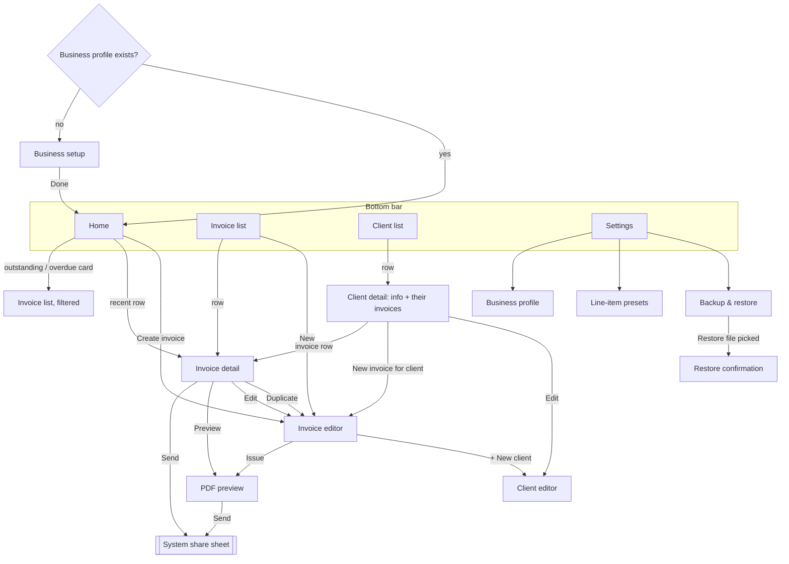

# UX Specification (Phase 2)

_Started 2026-10-16. Implements the screens in [MVP_SPEC.md](MVP_SPEC.md) section 3. Each Phase 2 task adds a section here._

| Task | Section | Status |
|---|---|---|
| P2-T01 Navigation | 1 | Draft, awaiting founder review |
| P2-T02 Home | — | Not started |
| P2-T03 Invoice editor | — | Not started |
| P2-T04 PDF preview / sending | — | Not started |
| P2-T05 History & statuses | — | Not started |
| P2-T06 Client management | — | Not started |
| P2-T07 Accessibility & localization | — | Not started |
| P2-T08 Design tokens | — | Not started |

---

## 1. Navigation (P2-T01)

### Design goals, from validation
1. **Quick tasks first** (A-02: check status, quick edit, re-send). Each must be reachable in **≤ 2 taps from opening the app**.
2. **Sending is never hidden** (T3 had the most friction). It is the primary button wherever an invoice is shown in full.
3. **Creating is fast enough to beat the laptop** (D-010). Create is always one tap from Home and Invoices, and Duplicate is one tap from any invoice.

### Structure

Single activity, Navigation Compose. Four bottom-bar tabs, each **keeping its own back stack**: leaving the Invoices tab while on an invoice and coming back returns to that invoice.

### Routes

Type-safe Navigation Compose routes (`@Serializable` objects and classes). This needs the Kotlin serialization plugin, which is added in P4-T01.

| Route | Arguments | Bottom bar | Notes |
|---|---|---|---|
| `Setup` | — | Hidden | Only when no business profile exists. Removed from the back stack when done (`popUpTo(Setup) { inclusive = true }`). |
| `Home` | — | Shown | Start destination of tab 1 |
| `InvoiceList` | `filter: Status? = null` | Shown | Start of tab 2. Home's cards open it pre-filtered (Unpaid, Overdue). |
| `ClientList` | — | Shown | Start of tab 3 |
| `Settings` | — | Shown | Start of tab 4 |
| `InvoiceDetail` | `invoiceId: Long` | Shown | |
| `InvoiceEditor` | `invoiceId: Long? = null`, `duplicateOf: Long? = null`, `clientId: Long? = null` | **Hidden** | Full-screen task with more room for the keyboard. New, edit, duplicate, or new for a given client. |
| `PdfPreview` | `invoiceId: Long` | **Hidden** | |
| `ClientDetail` | `clientId: Long` | Shown | |
| `ClientEditor` | `clientId: Long? = null`, `returnToEditor: Boolean = false` | Hidden | When opened from the invoice editor, the new client is selected on return. |
| `BusinessProfile`, `Presets`, `Backup` | — | Shown | Inside the Settings tab |
| `RestoreConfirm` | `fileUri: String` | Hidden | Shows counts before replacing data (MVP_SPEC section 7) |

### Back behaviour
| Situation | Back goes to | Why |
|---|---|---|
| Editor, any time | Previous screen. The **draft is already autosaved**, so there is **no "discard changes?" dialog**; a short message says "Draft saved". | Interruptions on a phone are normal; nothing is lost (UP-01). |
| Editor → **Issue** → Preview | Back from Preview goes to **Invoice detail**, not the editor. The editor is replaced (`popUpTo(InvoiceEditor) { inclusive = true }`, then Detail, then Preview). | After issuing, the invoice is "done". Returning to the form would feel like it wasn't saved. |
| Editing an issued invoice → **Save** | Back to where the edit started (Detail or Preview), which shows the updated data | Same as the prototype |
| Draft deleted from the editor | Back to the list it came from, with "Draft deleted · Undo" | |
| Tab re-selected while already on that tab | Pops to the tab's start screen | Standard Android behaviour |
| Back on a tab's start screen (not Home) | Home | Standard Material behaviour |
| Back on Home | Leaves the app | |

### Quick-task tap counts (target vs this design)
| Task | Path | Taps |
|---|---|---|
| "Who owes me?" | Open app → Home shows outstanding per currency and overdue count | **0** |
| See overdue invoices | Home → Overdue card | **1** |
| **Re-send an invoice** | Home → recent row → **Send** → pick app | **2** + pick app |
| Re-send an older one | Invoices tab → row → **Send** | **2** + pick app |
| Quick edit (e.g. due date) | Home/Invoices → row → Edit → change → Save | 4 |
| Mark paid | row → **Mark paid** | **2** |
| New invoice for a repeat client | Home → Create → pick from **recent clients** (top 3 shown as chips) → pick a preset item → Issue → Send | ~6–8 taps plus typing the amount |
| **Duplicate last month's invoice** | Row → **Duplicate** → (adjust) → Issue → Send | **4** + pick app |

### Invoice detail: action order
Following the T3 finding, the detail screen shows actions in this order:
1. **Send**: filled primary button (shows "Sent 16 Oct" underneath when sent before).
2. **Mark as paid** (or "Mark as unpaid"): tonal button.
3. Row of icon buttons with labels: **Preview**, **Edit**, **Duplicate**, **More** (Void, Delete draft).

Drafts show **Issue** instead of Send, and Mark paid is hidden.

### What this deliberately leaves out
- **No navigation drawer**: four tabs cover everything.
- **No floating "+" button**: Create is a full-width button on Home and a button on the Invoices list. A floating button on a phone screen covers the last list row, and the T3 testing showed people miss small controls.
- **No swipe actions on list rows** in the MVP: they're invisible to new users and to TalkBack. They could be added later as a shortcut.
- **No incoming deep links**: nothing outside the app opens PocketBill screens. The F-17 due-date notification (Could) would open Invoice detail.

### To validate
- In the P2-T04 redesign of sending, check with 2–3 participants that **Send** on Detail removes the T3 friction.
- Whether **recent clients as chips** plus **presets** bring a repeat invoice under 2 minutes is measured by P1-T07.
